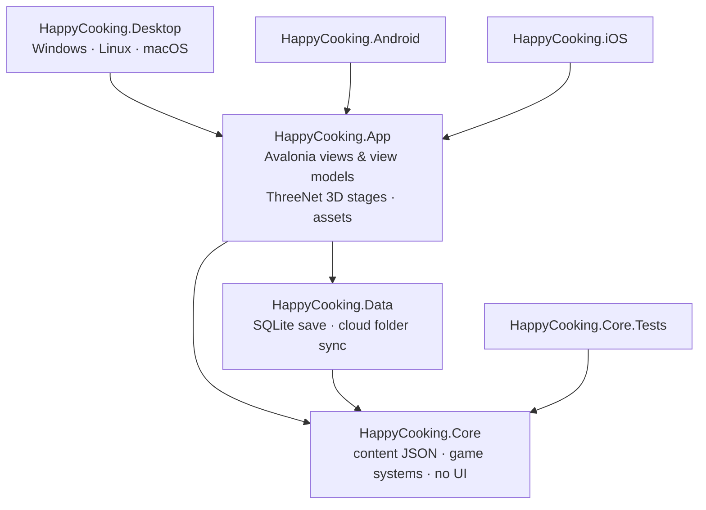

# Architecture

## Layers



| Project | Responsibility | Depends on |
|---|---|---|
| `HappyCooking.Core` | Content models and loader, player profile, every game rule. Trimmable and AOT-compatible, with no UI or storage code. | — |
| `HappyCooking.Data` | `SqliteSaveStore`, `FolderCloudSaveProvider`, `CloudSync`. | Core, Microsoft.Data.Sqlite |
| `HappyCooking.App` | Shared Avalonia UI, view models, 3D stages, services (audio, images, localisation, `GameHost`). | Core, Data, Avalonia, ThreeNet.Avalonia |
| `HappyCooking.Desktop` | `Program` (command line), `ScreenshotTour`. | App |
| `HappyCooking.Android` / `.iOS` | Thin platform launchers. | App |

## Game core

`GameSession` (in `src/HappyCooking.Core/GameSession.cs`) is the single entry point. It holds the immutable `GameContent`, the mutable `PlayerProfile`, an `IClock`, a seeded `GameRandom` and twelve systems wired to one `GameEvents` hub:

```
                 ┌────────────── GameEvents (struct events) ──────────────┐
                 │                                                         │
Economy ─ Inventory ─ Kitchen(CookingSession) ─ Farm ─ Fishing ─ Restaurant ─ Pets
   │                                                                   ▲
   └── raises LevelUp / RegionUnlocked ──► Quests, Achievements ───────┘ (listen)
World (day/night, weather) · Seasonal (calendar events) · Social (friend & gift codes)
```

- **Systems own the rules, the profile only holds data.** `PlayerProfile` is a plain class serialised with a source-generated `ProfileJsonContext`. `ProfileMigrations` upgrades older saves.
- **Events decouple systems.** A cooked dish raises `GameEvent(DishCooked, recipeId, stars, region)`. `QuestSystem` and `AchievementSystem` subscribe and react, and the kitchen knows neither of them. `GameEvent` is a `readonly record struct`, so raising one never allocates.
- **`CookingSession`** is engine-agnostic. The UI calls `Update(dt)` each frame and forwards `Tap`, `SetHolding`, `Stop` and `Pick`. Each step is a `StepState` subclass: `TapStep`, `MeterStep` (Heat/Pour), `RhythmStep`, `PickStep`, `DecorateStep`.
- **Time is injected.** Farm growth, pet hunger, weather and events read `IClock`, so tests use `ManualClock`.
- **The world is stateless.** Day/night (a 24-minute day) and weather (changes every 6 minutes, hashed per region) are derived from the wall clock, so every screen agrees without sharing state.

## Content

All content is JSON embedded in Core (`Content/Data/*.json`): regions, ingredients, recipes, characters, pets, crops, fish, quests, achievements, decorations, events and UI strings. `ContentLoader` reads it with a source-generated `JsonSerializerContext`. `GameContent` exposes lists plus `FrozenDictionary` lookups, and `Validate()` checks every cross-reference. The `ContentTests` run it. See the [content guide](content-guide.md).

## App and UI

- **`GameHost.Current`** is the app-wide singleton. It creates the session from SQLite (or the demo profile), owns `Sfx`, autosaves every 15 seconds when dirty, ticks the farm 4 times a second, and turns game events into toasts.
- **MVVM with CommunityToolkit.Mvvm.** `ShellViewModel` owns the HUD, the dock, toasts and navigation. Each screen is a `PageViewModel`, created fresh on every visit. Views are mapped in `ShellView.axaml` with compiled `DataTemplate`s, so there is no reflection-based view locator.
- **Theme.** `Theme/Tokens.axaml` holds colours, fonts (Lilita One, Nunito) and the "sticker" shadow. `Theme/Controls.axaml` styles cards, pills and buttons that sink into their shadow when pressed.
- **Localisation.** Core's `Localizer` reads `strings.json`. The App's `Loc` exposes a bindable indexer, and `{svc:Tr key}` in XAML updates when the language changes. View models re-read content text in `RefreshTexts()`.

## 3D

- A **`Stage`** owns one ThreeNet `Scene`, its camera, lights, actors and particle effects. Stages include `TitleStage`, `KitchenStage`, `RestaurantStage`, `FarmStage`, `FishingStage` and `DishPreviewStage`.
- **`StageHost`** wraps `ThreeNetView`. It applies the renderer options for the chosen graphics quality and calls `Stage.Update` once per rendered frame. The stage raises `Updated`, which pages use to step their game logic in sync with the picture.
- **`CharacterActor`** loads a rigged GLB with its own clips (Idle, Happy, Talk) and returns to Idle after a one-shot clip.
- **`Props`** builds set dressing (counters, tables, trees, decorations) from primitives.
- **`ParticleFx`** covers steam, sparkles, rain and snow. `FireEffect` and `WaterSurface` come from ThreeNet.Effects.

## Saving

```
GameHost.Touch() ─► dirty ─► (every 15 s) SqliteSaveStore.Save ─► happycooking.db (WAL)
Settings ▸ Sync now ─► CloudSync.Sync(FolderCloudSaveProvider)  newest UpdatedUtc wins
                       └─ remote newer ─► stored to SQLite + GameHost.LockSaves() ─► restart to load
```

- The profile is one JSON document per slot in the `saves` table. Cooking history goes in the `cooking_log` table.
- Cloud writes go to a temp file first and are then moved into place, so a half-synced file is never read.
- When storage is unavailable, the game keeps playing in memory (`MemorySaveStore`).

## Performance and memory

| Technique | Where |
|---|---|
| `FrozenDictionary` lookups for all content | `GameContent` |
| Only one 3D scene alive: a stage is created when its page opens and disposed when it closes | `PageViewModel.OnDeactivated` |
| Checkerboard floors drawn as two instanced meshes | `Props.CheckerFloor` |
| GLB bytes read from the package once; static models cloned within a scene | `ModelLibrary` |
| Per-scene cache of materials and geometry, so 16 chairs share one cylinder | `Props` |
| Particle buffers allocated once and rewritten each frame | `ParticleFx` |
| Struct events and `stackalloc` in hot paths, no LINQ in per-frame code | `GameEvents`, `FishingSystem` |
| Bitmaps decoded at display width | `Images` |
| Sound effects and music synthesised at start-up (no audio files) | `Sfx` |
| Assets optimised: 131 MB of raw models down to 6.3 MB | [asset pipeline](asset-pipeline.md) |
| Graphics quality (Low/Medium/High) controls MSAA, shadows, SSAO, bloom, render scale and frame cap | `Stage.OptionsFor` |

---

*Dibuat oleh Ariana Mischa Fadhila dari Syubadubin Studios*
