# Player guide

Happy Cooking is made for children aged 5–12. Nothing can be failed: a step that goes badly still earns some points, and every finished dish gets at least one star. Switch between English and Bahasa Indonesia at any time with the **ID / EN** button in the top-right corner.

## The screen

- **Top left**: your level, XP bar, name and the pet that is with you.
- **Top right**: the active seasonal event (hover it for details), coins, gems and the language button.
- **Bottom dock**: Map, Recipes, Restaurant, Farm, Fishing, Pets, Trophies, Friends, Settings.

## Title

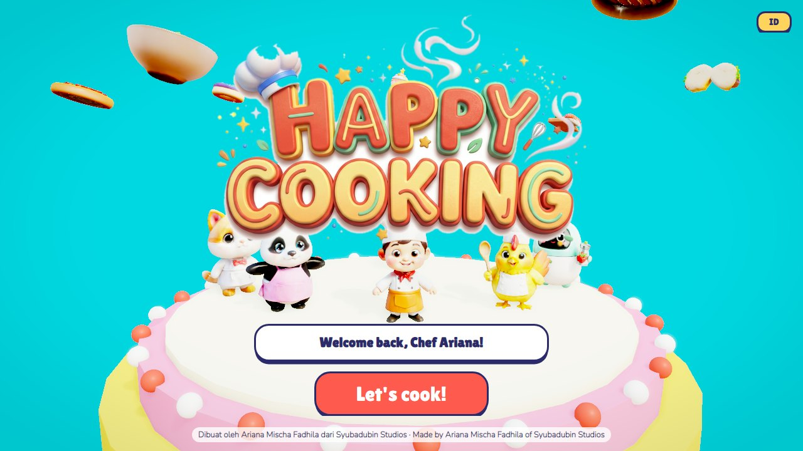

The first time you play, type your name and press **Let's cook!**

## World map

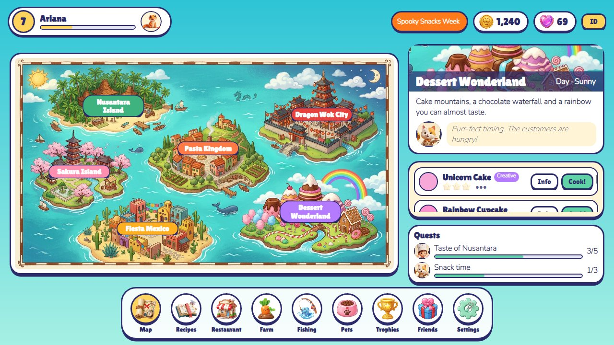

Tap an island to see its host, weather, time of day and dishes. Islands open as you level up:

| Island | Level | Host |
|---|---|---|
| Nusantara Island | 1 | Chef Happy |
| Sakura Island | 2 | Mochi the Cat |
| Pasta Kingdom | 3 | Jenggo the Chicken Chef |
| Dragon Wok City | 4 | Coco the Panda |
| Fiesta Mexico | 5 | Pepper Bot |
| Dessert Wonderland | 6 | Mochi the Cat |

Press **Cook!** on a dish to go to the kitchen, or **Info** to open it in the recipe book. Your next two quests are shown under the dishes.

## Kitchen

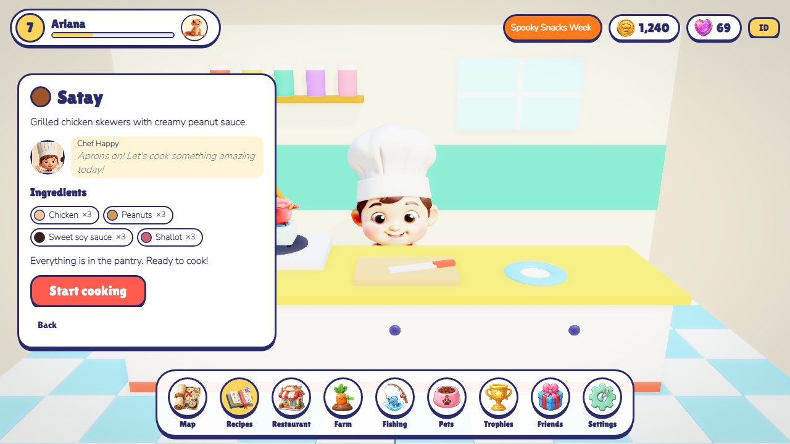

First check the ingredients. Missing ones are shown in red; press **Buy** to get them at market price. Then press **Start cooking**. Each recipe is 3–5 steps, and each step is one of six mini-games:

| Mini-game | What to do |
|---|---|
| **Tap** (chop, slice, knead, whisk…) | Press the big button as fast as you can. Quick is perfect, slow is still fine. |
| **Heat** (fry, bake, boil, grill…) | The needle rises on its own. Press **Stop!** when it is in the green zone. If you wait until the end, the dish gets burnt and Mr. Burnt Onion pops up. |
| **Pour** (sauce, season, sprinkle…) | Hold the button to pour and let go in the green zone. |
| **Rhythm** (stir, flip, roll…) | A yellow ball bounces left and right. Tap when it is in the green, a few times. |
| **Pick** | Choose the right ingredients from a tray that also holds decoys. |
| **Decorate** | Tap the plate to place toppings anywhere you like. This step always gets full marks. |

On a keyboard, the **Space** bar works as the big button.

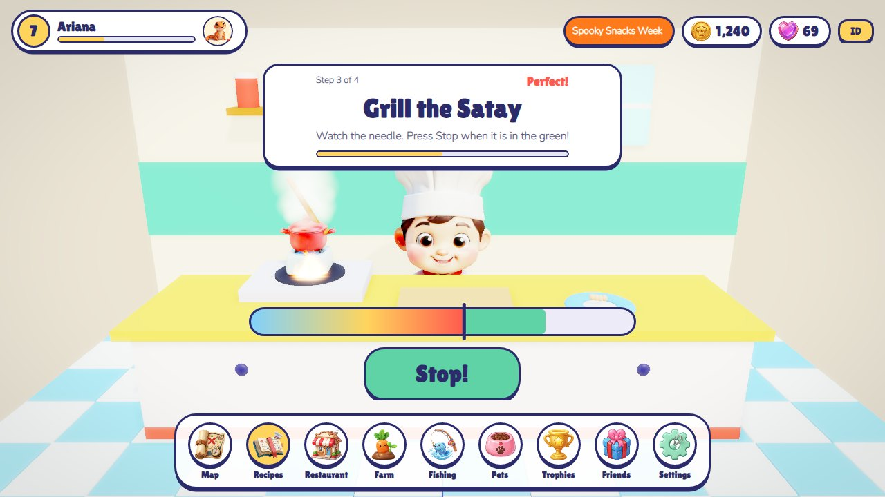

At the end you get 1–3 stars, coins, XP and a fun fact about the dish. The dish goes onto the restaurant counter.

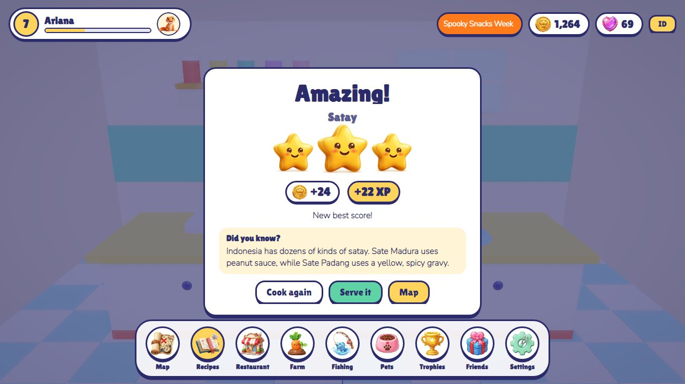

## Restaurant

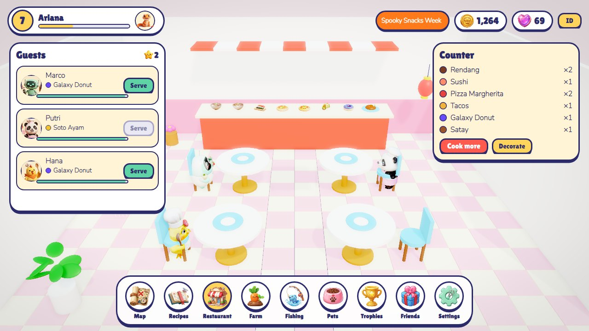

Guests sit down and order dishes you have already learned. If the dish is on the counter, press **Serve**. You get paid, plus a tip that grows the faster you serve. A guest whose patience bar runs out goes home. Press **Decorate** to buy decorations. They appear in the room and raise your star rating, which brings guests sooner and adds to tips.

## Farm

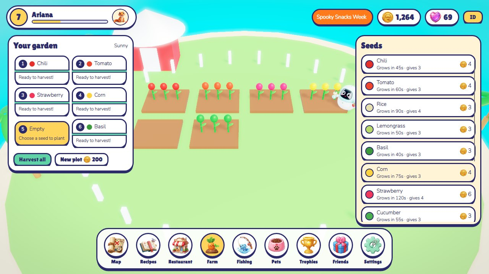

Choose an empty plot (in the list or by tapping it in 3D) and pick a seed. Crops grow in real time, even on other screens. Rain makes them grow faster. Press **Harvest** or **Harvest all** to put the produce in your pantry. You can buy up to 12 plots.

## Fishing

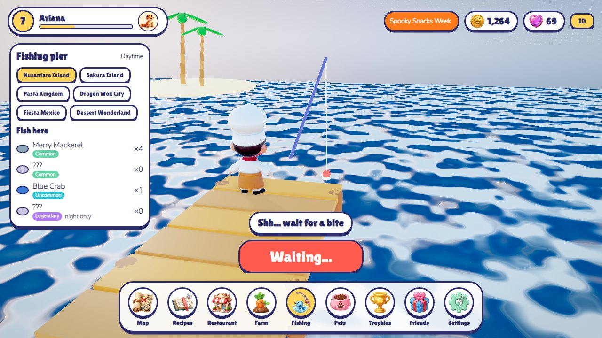

Choose an island spot. Then use the one big button:

1. **Cast** the line.
2. Wait. Pulling too early scares the fish away.
3. When it says **A bite!**, tap quickly to hook the fish.
4. **Reel!**: tap many times before the timer runs out. Rarer fish need more taps.

Some fish (Moon Squid, Galaxy Fish) only bite at **night**. In-game time follows a 24-minute day. Caught fish go into your pantry as ingredients, and the fish list fills in as you discover them.

## Pets

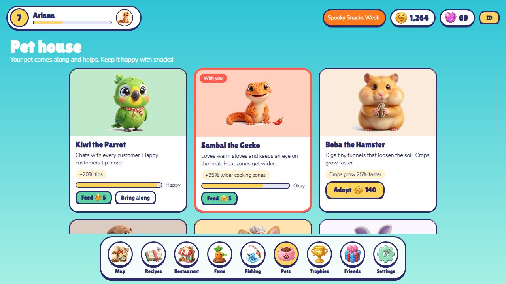

Adopt a pet with coins (or gems for the rarest) and **Bring along** the one you want to help you:

| Pet | Bonus |
|---|---|
| Kiwi the Parrot | +20% tips |
| Sambal the Gecko | +25% wider cooking zones |
| Boba the Hamster | crops grow 25% faster |
| Pip the Otter | +30% rare fish luck |
| Mango the Corgi | +20% cooking XP |
| Luna the Bunny | guests wait 30% longer |
| Draco the Baby Dragon | +45% wider cooking zones |
| Stella the Star Whale | +60% rare fish luck |

Pets get hungry slowly in real time. **Feed** costs 5 coins. A pet only helps when its happiness is at least 30.

## Recipe book

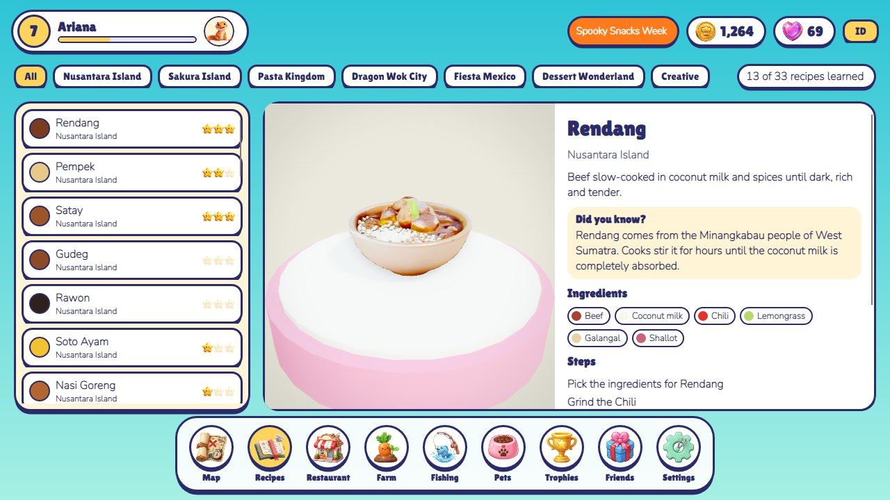

Browse every dish by island, or only the **Creative** ones (Galaxy Donut, Space Sushi, Mermaid Soup…). Each dish spins on a turntable next to its story, fun fact, ingredients, steps, your best stars and the rewards.

## Trophies and quests

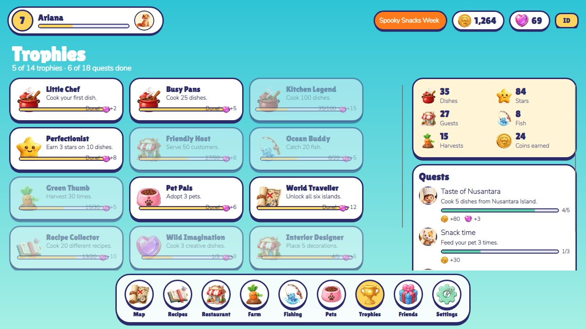

Trophies reward lifetime milestones with gems. Quests come from the cast in a story order, and finishing one opens the next.

## Friends and gifts

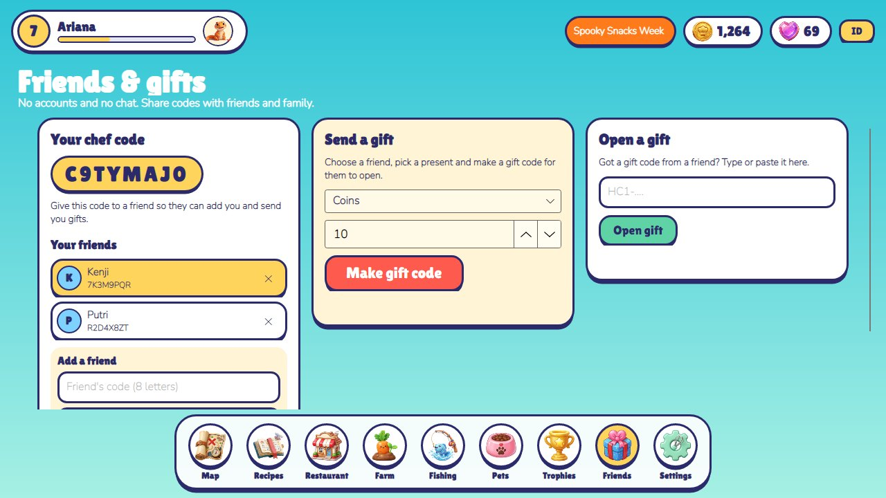

There are no accounts and no chat. Every player has an 8-character **chef code**.

- **Add a friend**: type their code and a name.
- **Send a gift**: choose a friend and up to 100 coins or 10 of one ingredient, then press **Make gift code**. The gift leaves your pantry, and you get a code like `HC1-XXXX-XXXX-…` to pass on.
- **Open a gift**: paste a code you received. Each gift can be opened once, only by the chef it was made for. Typos are caught by a checksum.

## Settings

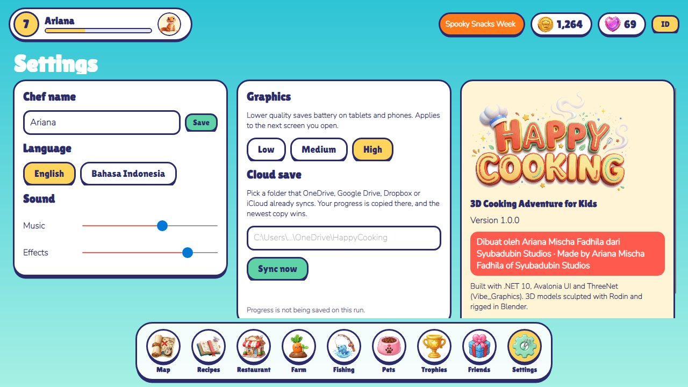

- Chef name, language, music and effects volume.
- **Graphics**: Low, Medium or High. Lower settings save battery on tablets and apply to the next screen you open.
- **Cloud save**: enter a folder that OneDrive, Google Drive, Dropbox or iCloud Drive already syncs and press **Sync now**. The newest copy wins. If a newer save from another device is found, restart the game to play it.
- The About card shows the version and the credits.

## Seasonal events

Events follow the calendar and give extra coins for their featured recipes:

| Event | Dates | Featured |
|---|---|---|
| Lunar New Year Feast | 20 Jan – 20 Feb | Dim Sum, Baozi, Rainbow Dragon Noodles |
| Blossom Picnic | 20 Mar – 20 Apr | Sushi, Onigiri, Gelato |
| Indonesian Independence Cook-Off | 10 – 24 Aug | Nasi Goreng, Satay, Klepon, Rendang |
| Spooky Snacks Week | 15 Oct – 2 Nov | Galaxy Donut, Robot Cookies, Churros |
| Winter Wonder Treats | 10 – 31 Dec | Unicorn Cake, Cloud Pancake, Rainbow Cupcake |

---

*Dibuat oleh Ariana Mischa Fadhila dari Syubadubin Studios*
