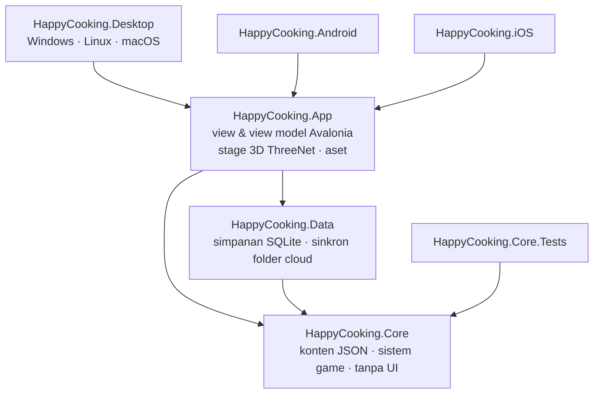

# Arsitektur

## Lapisan



| Proyek | Tanggung jawab | Bergantung pada |
|---|---|---|
| `HappyCooking.Core` | Model dan pemuat konten, profil pemain, semua aturan game. Bisa di-trim dan kompatibel AOT, tanpa kode UI atau penyimpanan. | — |
| `HappyCooking.Data` | `SqliteSaveStore`, `FolderCloudSaveProvider`, `CloudSync`. | Core, Microsoft.Data.Sqlite |
| `HappyCooking.App` | UI Avalonia bersama, view model, stage 3D, layanan (audio, gambar, lokalisasi, `GameHost`). | Core, Data, Avalonia, ThreeNet.Avalonia |
| `HappyCooking.Desktop` | `Program` (argumen baris perintah), `ScreenshotTour`. | App |
| `HappyCooking.Android` / `.iOS` | Peluncur tipis untuk tiap platform. | App |

## Inti game

`GameSession` (di `src/HappyCooking.Core/GameSession.cs`) adalah satu-satunya pintu masuk. Isinya `GameContent` yang tidak berubah, `PlayerProfile` yang bisa berubah, sebuah `IClock`, `GameRandom` ber-seed, dan dua belas sistem yang terhubung ke satu hub `GameEvents`:

```
                 ┌────────────── GameEvents (event berupa struct) ─────────┐
                 │                                                         │
Economy ─ Inventory ─ Kitchen(CookingSession) ─ Farm ─ Fishing ─ Restaurant ─ Pets
   │                                                                   ▲
   └── memicu LevelUp / RegionUnlocked ──► Quests, Achievements ───────┘ (mendengarkan)
World (siang/malam, cuaca) · Seasonal (event kalender) · Social (kode teman & hadiah)
```

- **Sistem memegang aturan, profil hanya menyimpan data.** `PlayerProfile` adalah kelas biasa yang diserialisasi dengan `ProfileJsonContext` hasil source generator. `ProfileMigrations` memperbarui simpanan versi lama.
- **Event memisahkan antar-sistem.** Hidangan yang selesai memicu `GameEvent(DishCooked, recipeId, stars, region)`. `QuestSystem` dan `AchievementSystem` mendengarkan dan bereaksi, sementara dapur tidak mengenal keduanya. `GameEvent` adalah `readonly record struct`, jadi memicu event tidak pernah mengalokasikan memori.
- **`CookingSession`** tidak bergantung pada engine. UI memanggil `Update(dt)` setiap frame dan meneruskan `Tap`, `SetHolding`, `Stop`, dan `Pick`. Setiap langkah adalah turunan `StepState`: `TapStep`, `MeterStep` (Panas/Tuang), `RhythmStep`, `PickStep`, `DecorateStep`.
- **Waktu disuntikkan.** Pertumbuhan tanaman, rasa lapar hewan, cuaca, dan event membaca `IClock`, sehingga test memakai `ManualClock`.
- **Dunia tidak menyimpan state.** Siang/malam (satu hari 24 menit) dan cuaca (berganti tiap 6 menit, di-hash per wilayah) dihitung dari jam dinding, sehingga semua layar selalu sepakat tanpa berbagi state.

## Konten

Semua konten berupa JSON yang ditanam di Core (`Content/Data/*.json`): wilayah, bahan, resep, tokoh, hewan, tanaman, ikan, misi, trofi, dekorasi, event, dan teks UI. `ContentLoader` membacanya dengan `JsonSerializerContext` hasil source generator. `GameContent` menyediakan daftar dan pencarian lewat `FrozenDictionary`, dan `Validate()` memeriksa setiap referensi silang. `ContentTests` menjalankan validasi itu. Lihat [panduan konten](content-guide.md).

## Aplikasi dan UI

- **`GameHost.Current`** adalah singleton untuk seluruh aplikasi. Ia membuat sesi dari SQLite (atau profil demo), memegang `Sfx`, melakukan autosave tiap 15 detik bila ada perubahan, menjalankan kebun 4 kali per detik, dan mengubah event game menjadi toast.
- **MVVM dengan CommunityToolkit.Mvvm.** `ShellViewModel` mengatur HUD, dock, toast, dan navigasi. Setiap layar adalah `PageViewModel` yang dibuat baru di setiap kunjungan. View dipetakan di `ShellView.axaml` dengan `DataTemplate` terkompilasi, jadi tidak ada view locator berbasis reflection.
- **Tema.** `Theme/Tokens.axaml` berisi warna, font (Lilita One, Nunito), dan bayangan "stiker". `Theme/Controls.axaml` mengatur gaya kartu, pill, dan tombol yang tenggelam ke bayangannya saat ditekan.
- **Lokalisasi.** `Localizer` di Core membaca `strings.json`. `Loc` di App menyediakan indexer yang bisa di-binding, dan `{svc:Tr key}` di XAML ikut berganti saat bahasa diubah. View model membaca ulang teks konten di `RefreshTexts()`.

## 3D

- Sebuah **`Stage`** memiliki satu `Scene` ThreeNet beserta kamera, lampu, aktor, dan efek partikelnya. Stage yang ada antara lain `TitleStage`, `KitchenStage`, `RestaurantStage`, `FarmStage`, `FishingStage`, dan `DishPreviewStage`.
- **`StageHost`** membungkus `ThreeNetView`. Ia menerapkan opsi renderer sesuai kualitas grafis dan memanggil `Stage.Update` sekali per frame. Stage memicu `Updated`, yang dipakai halaman untuk menjalankan logika game seirama dengan gambar.
- **`CharacterActor`** memuat GLB yang sudah di-rig beserta klip miliknya sendiri (Idle, Happy, Talk) dan kembali ke Idle setelah klip sekali-jalan selesai.
- **`Props`** membangun properti latar (meja dapur, meja makan, pohon, dekorasi) dari bentuk primitif.
- **`ParticleFx`** menangani uap, kilau, hujan, dan salju. `FireEffect` dan `WaterSurface` berasal dari ThreeNet.Effects.

## Penyimpanan

```
GameHost.Touch() ─► ditandai berubah ─► (tiap 15 dtk) SqliteSaveStore.Save ─► happycooking.db (WAL)
Pengaturan ▸ Sinkronkan ─► CloudSync.Sync(FolderCloudSaveProvider)  UpdatedUtc terbaru yang menang
                           └─ cloud lebih baru ─► disimpan ke SQLite + GameHost.LockSaves() ─► mulai ulang untuk memuat
```

- Profil disimpan sebagai satu dokumen JSON per slot di tabel `saves`. Riwayat memasak masuk ke tabel `cooking_log`.
- Penulisan ke cloud dibuat di file sementara dulu, lalu dipindahkan ke tempatnya, sehingga file yang baru setengah tersinkron tidak pernah terbaca.
- Kalau penyimpanan tidak tersedia, game tetap berjalan di memori (`MemorySaveStore`).

## Performa dan memori

| Teknik | Lokasi |
|---|---|
| Pencarian konten dengan `FrozenDictionary` | `GameContent` |
| Hanya satu scene 3D yang hidup: stage dibuat saat halamannya dibuka dan dibuang saat ditutup | `PageViewModel.OnDeactivated` |
| Lantai kotak-kotak digambar sebagai dua mesh instanced | `Props.CheckerFloor` |
| Byte GLB dibaca sekali dari paket; model statis di-clone dalam satu scene | `ModelLibrary` |
| Cache material dan geometri per scene, sehingga 16 kursi berbagi satu silinder | `Props` |
| Buffer partikel dialokasikan sekali dan ditulis ulang tiap frame | `ParticleFx` |
| Event berupa struct dan `stackalloc` di jalur panas, tanpa LINQ di kode per-frame | `GameEvents`, `FishingSystem` |
| Bitmap di-decode sesuai lebar tampilan | `Images` |
| Efek suara dan musik disintesis saat mulai (tanpa file audio) | `Sfx` |
| Aset dioptimasi: model mentah 131 MB menjadi 6,3 MB | [pipeline aset](asset-pipeline.md) |
| Kualitas grafis (Rendah/Sedang/Tinggi) mengatur MSAA, bayangan, SSAO, bloom, skala render, dan batas FPS | `Stage.OptionsFor` |

---

*Dibuat oleh Ariana Mischa Fadhila dari Syubadubin Studios*
