# Panduan pemain

Happy Cooking dibuat untuk anak usia 5–12 tahun. Tidak ada yang bisa gagal: langkah yang kurang bagus tetap dapat nilai, dan setiap hidangan yang selesai minimal mendapat satu bintang. Ganti bahasa kapan saja dengan tombol **ID / EN** di pojok kanan atas.

## Tampilan layar

- **Kiri atas**: level, bar XP, nama, dan hewan peliharaan yang sedang menemanimu.
- **Kanan atas**: event musiman yang aktif (arahkan kursor untuk detailnya), koin, permata, dan tombol bahasa.
- **Dock bawah**: Peta, Resep, Restoran, Kebun, Mancing, Hewan, Trofi, Teman, Pengaturan.

## Layar judul

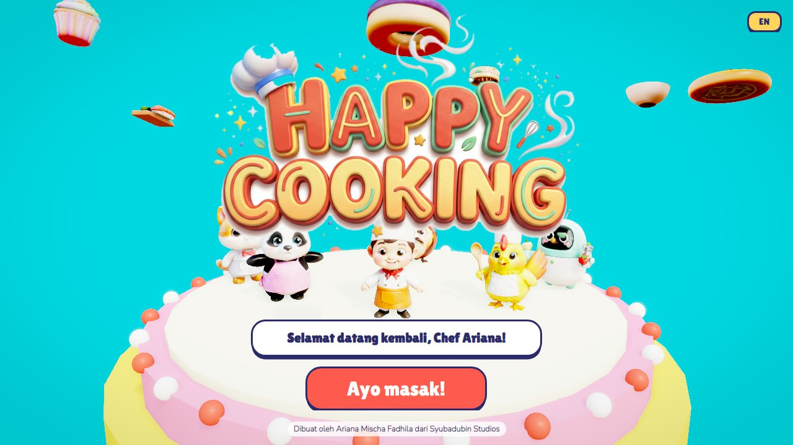

Saat pertama kali bermain, tulis namamu lalu tekan **Ayo masak!**

## Peta dunia

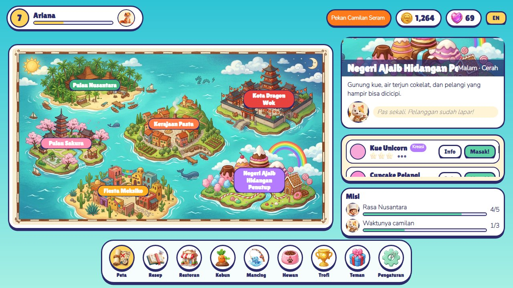

Ketuk sebuah pulau untuk melihat tuan rumah, cuaca, waktu, dan hidangannya. Pulau terbuka seiring naiknya level:

| Pulau | Level | Tuan rumah |
|---|---|---|
| Pulau Nusantara | 1 | Chef Happy |
| Pulau Sakura | 2 | Mochi si Kucing |
| Kerajaan Pasta | 3 | Jenggo si Koki Ayam |
| Kota Dragon Wok | 4 | Coco si Panda |
| Fiesta Meksiko | 5 | Pepper Bot |
| Negeri Ajaib Hidangan Penutup | 6 | Mochi si Kucing |

Tekan **Masak!** pada sebuah hidangan untuk masuk ke dapur, atau **Info** untuk membukanya di buku resep. Dua misi berikutnya tampil di bawah daftar hidangan.

## Dapur

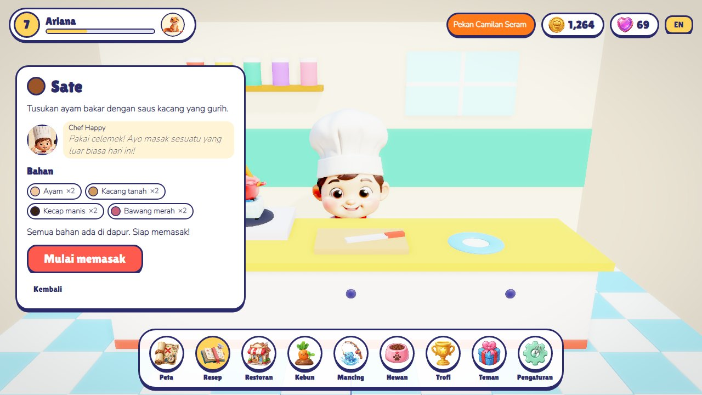

Periksa bahan dulu. Bahan yang kurang ditandai merah; tekan **Beli** untuk membelinya dengan harga pasar. Lalu tekan **Mulai memasak**. Setiap resep punya 3–5 langkah, dan setiap langkah adalah salah satu dari enam mini-game:

| Mini-game | Cara bermain |
|---|---|
| **Tekan** (potong, iris, uleni, kocok…) | Tekan tombol besar secepat mungkin. Cepat itu sempurna, pelan pun tidak apa-apa. |
| **Panas** (goreng, panggang, rebus, bakar…) | Jarum naik sendiri. Tekan **Stop!** saat jarum masuk area hijau. Kalau ditunggu sampai habis, masakan gosong dan Tuan Bawang Gosong muncul. |
| **Tuang** (saus, bumbu, tabur…) | Tahan tombol untuk menuang, lalu lepas di area hijau. |
| **Ritme** (aduk, balik, gulung…) | Bola kuning memantul ke kiri dan kanan. Tekan saat bola ada di area hijau, beberapa kali. |
| **Pilih** | Pilih bahan yang benar dari nampan yang juga berisi bahan jebakan. |
| **Hias** | Ketuk piring untuk menaruh topping di mana saja. Langkah ini selalu dapat nilai penuh. |

Di keyboard, tombol **Spasi** berfungsi sebagai tombol besar.

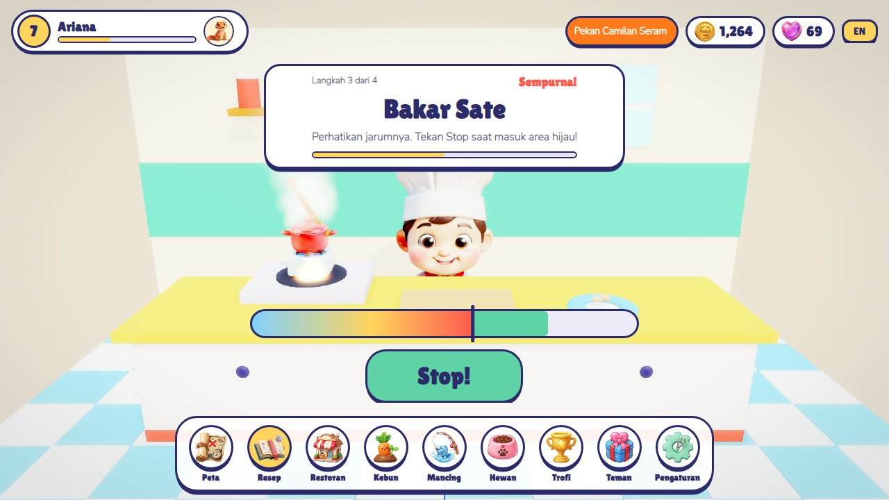

Di akhir kamu mendapat 1–3 bintang, koin, XP, dan fakta menarik tentang hidangan itu. Hidangannya lalu ditaruh di meja saji restoran.

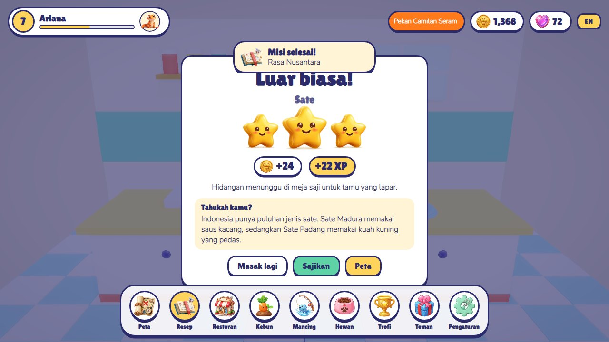

## Restoran

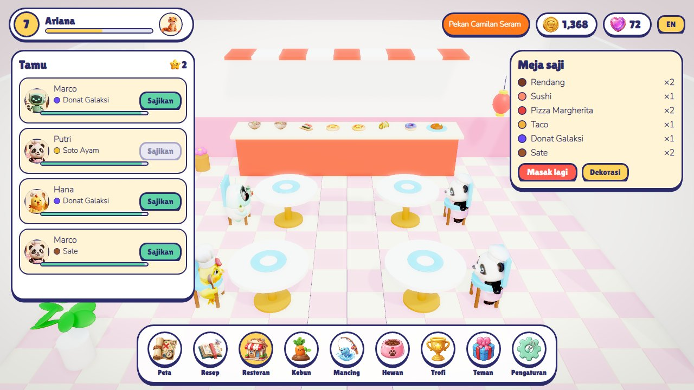

Tamu duduk dan memesan hidangan yang sudah kamu pelajari. Kalau hidangannya ada di meja saji, tekan **Sajikan**. Kamu dibayar, ditambah tip yang makin besar kalau kamu melayani lebih cepat. Tamu yang bar kesabarannya habis akan pulang. Tekan **Dekorasi** untuk membeli dekorasi. Dekorasi muncul di ruangan dan menaikkan rating bintang, sehingga tamu datang lebih cepat dan tip bertambah.

## Kebun

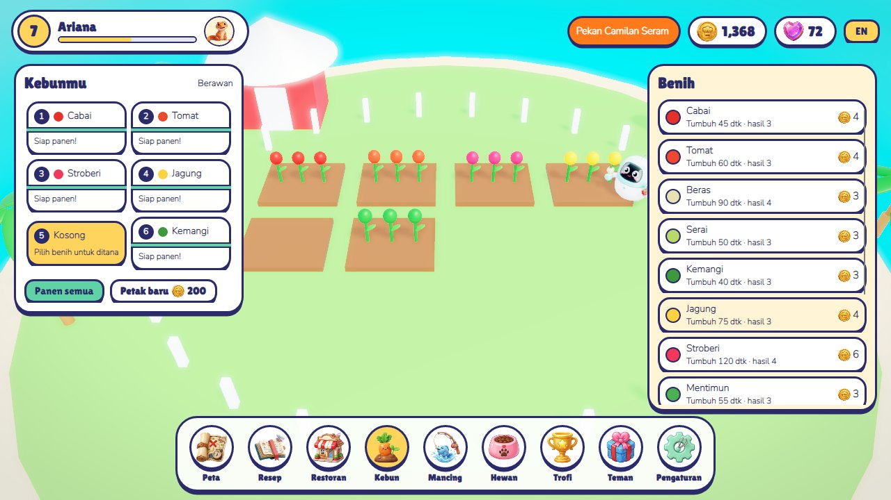

Pilih petak kosong (dari daftar atau dengan mengetuknya di 3D), lalu pilih benih. Tanaman tumbuh secara real-time, bahkan saat kamu di layar lain. Hujan mempercepat pertumbuhan. Tekan **Panen** atau **Panen semua** untuk memasukkan hasil ke dapur. Kamu bisa membeli hingga 12 petak.

## Memancing

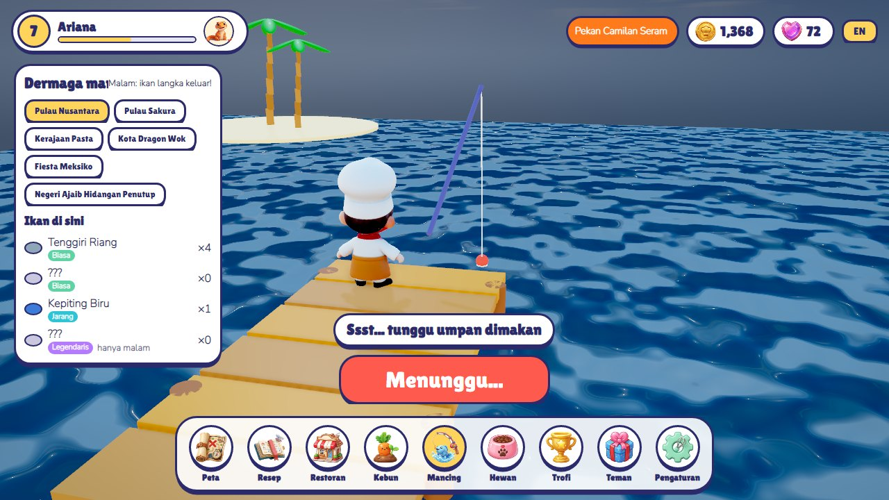

Pilih lokasi pulau. Lalu pakai satu tombol besar:

1. **Lempar** kailnya.
2. Tunggu. Menarik terlalu cepat membuat ikan kabur.
3. Saat muncul **Ada yang makan!**, tekan cepat untuk mengait ikan.
4. **Tarik!**: tekan berkali-kali sebelum waktunya habis. Ikan yang lebih langka butuh lebih banyak tekanan.

Beberapa ikan (Cumi Bulan, Ikan Galaksi) hanya muncul di **malam hari**. Waktu dalam game mengikuti hari sepanjang 24 menit. Ikan yang tertangkap masuk ke dapur sebagai bahan masakan, dan daftar ikan terisi saat kamu menemukannya.

## Hewan peliharaan

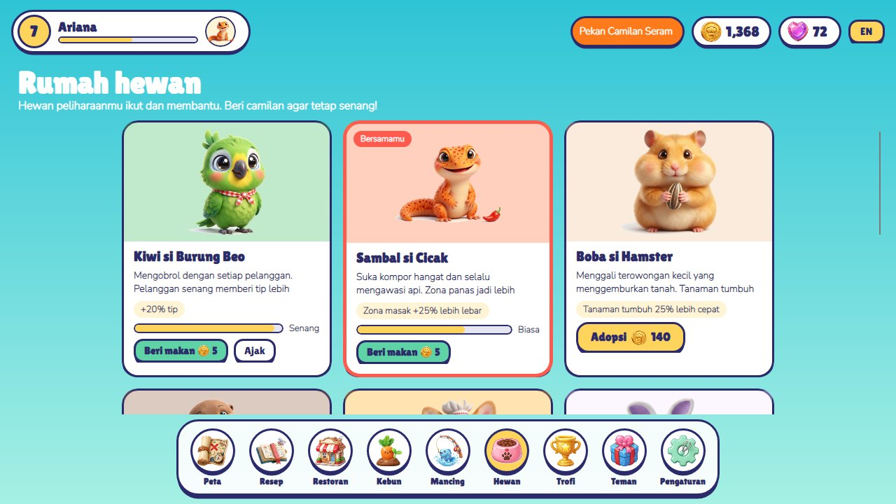

Adopsi hewan dengan koin (atau permata untuk yang paling langka), lalu tekan **Ajak** pada hewan yang ingin menemanimu:

| Hewan | Bonus |
|---|---|
| Kiwi si Burung Beo | +20% tip |
| Sambal si Cicak | zona masak +25% lebih lebar |
| Boba si Hamster | tanaman tumbuh 25% lebih cepat |
| Pip si Berang-berang | peluang ikan langka +30% |
| Mango si Corgi | XP memasak +20% |
| Luna si Kelinci | tamu menunggu 30% lebih lama |
| Draco si Bayi Naga | zona masak +45% lebih lebar |
| Stella si Paus Bintang | peluang ikan langka +60% |

Hewan pelan-pelan lapar secara real-time. **Beri makan** seharga 5 koin. Hewan hanya membantu kalau tingkat senangnya minimal 30.

## Buku resep

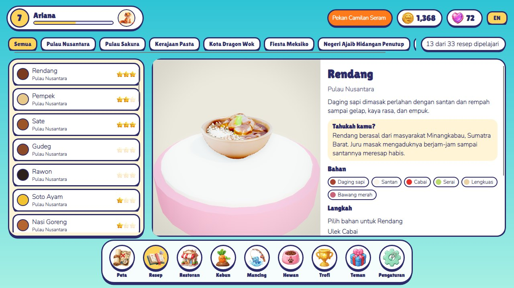

Lihat semua hidangan per pulau, atau hanya yang **Kreasi** (Donat Galaksi, Sushi Luar Angkasa, Sup Putri Duyung…). Setiap hidangan berputar di atas meja putar, di samping cerita, fakta menarik, bahan, langkah, bintang terbaikmu, dan hadiahnya.

## Trofi dan misi

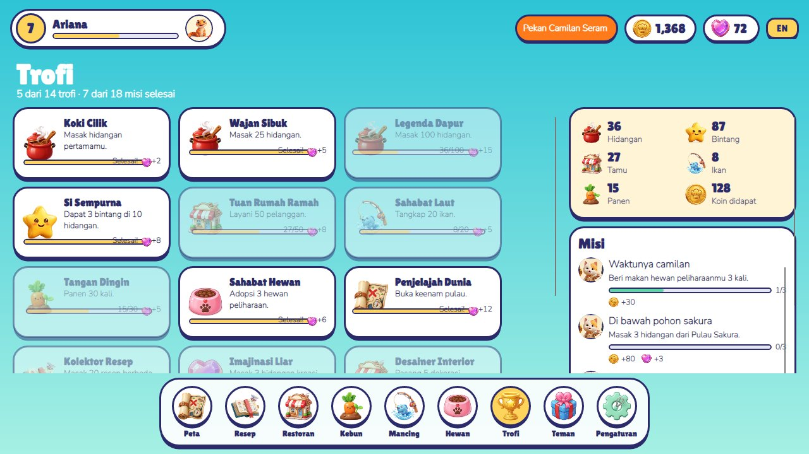

Trofi memberi permata untuk pencapaian sepanjang permainan. Misi datang dari para tokoh secara berurutan, dan menyelesaikan satu misi membuka misi berikutnya.

## Teman dan hadiah

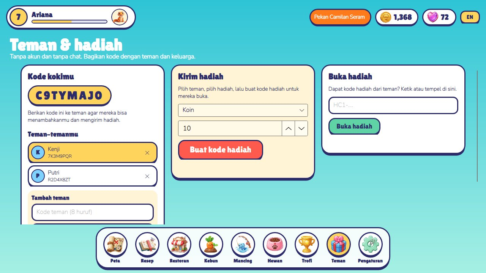

Tidak ada akun dan tidak ada chat. Setiap pemain punya **kode koki** 8 karakter.

- **Tambah teman**: ketik kode dan nama mereka.
- **Kirim hadiah**: pilih teman dan hingga 100 koin atau 10 buah satu jenis bahan, lalu tekan **Buat kode hadiah**. Hadiah diambil dari persediaanmu, dan kamu mendapat kode seperti `HC1-XXXX-XXXX-…` untuk diberikan.
- **Buka hadiah**: tempel kode yang kamu terima. Setiap hadiah hanya bisa dibuka sekali, oleh koki tujuannya. Salah ketik dideteksi lewat checksum.

## Pengaturan

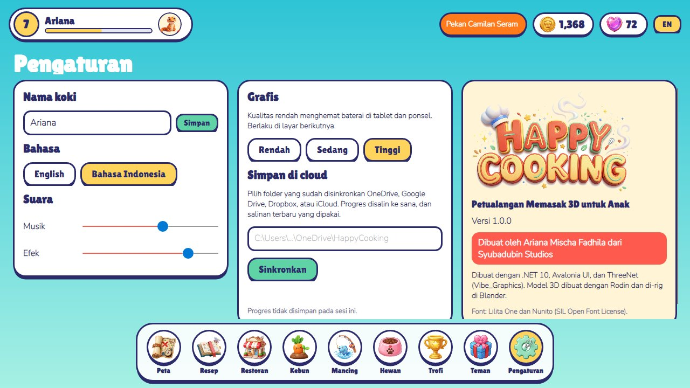

- Nama koki, bahasa, volume musik dan efek.
- **Grafis**: Rendah, Sedang, atau Tinggi. Pengaturan rendah menghemat baterai tablet dan berlaku di layar berikutnya yang kamu buka.
- **Simpan di cloud**: isi folder yang sudah disinkronkan OneDrive, Google Drive, Dropbox, atau iCloud Drive, lalu tekan **Sinkronkan**. Salinan terbaru yang dipakai. Kalau ditemukan simpanan lebih baru dari perangkat lain, mulai ulang game untuk memainkannya.
- Kartu Tentang menampilkan versi dan kredit.

## Event musiman

Event mengikuti kalender dan memberi koin ekstra untuk resep pilihannya:

| Event | Tanggal | Resep pilihan |
|---|---|---|
| Pesta Tahun Baru Imlek | 20 Jan – 20 Feb | Dim Sum, Bakpao, Mi Naga Pelangi |
| Piknik Musim Semi | 20 Mar – 20 Apr | Sushi, Onigiri, Gelato |
| Lomba Masak 17 Agustus | 10 – 24 Agt | Nasi Goreng, Sate, Klepon, Rendang |
| Pekan Camilan Seram | 15 Okt – 2 Nov | Donat Galaksi, Kue Kering Robot, Churros |
| Hidangan Musim Dingin | 10 – 31 Des | Kue Unicorn, Panekuk Awan, Cupcake Pelangi |

---

*Dibuat oleh Ariana Mischa Fadhila dari Syubadubin Studios*
